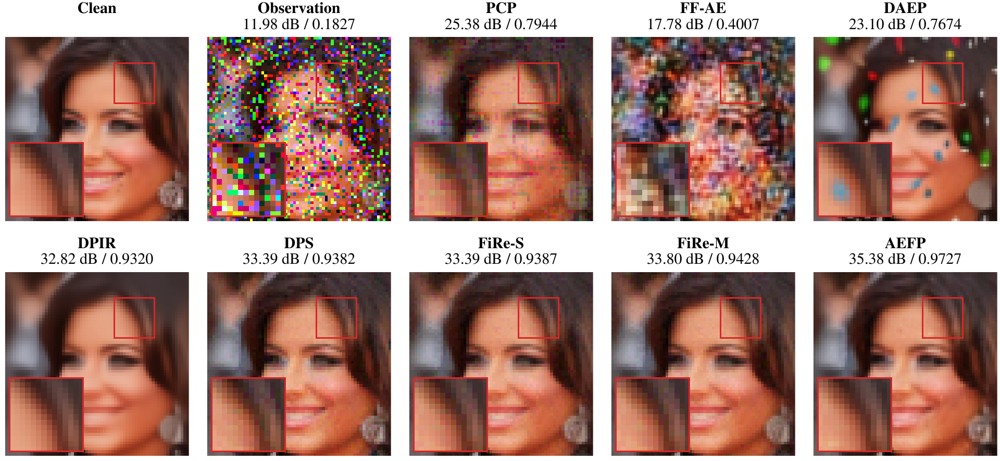

# AEFP

Implementation and experiments for AEFP, an autoencoder-based method for image recovery.

> Most of the core code is now available. The baseline implementations, datasets, and checkpoints will be released within one week.

## Setup

Use Python 3.9 and PyTorch 2.0.1 with a compatible CUDA build for GPU runs. Run commands from the repository root.

```bash
python -m pip install -r requirements.txt
```

When the data and checkpoint bundle is available, extract it into the repository root, preserving `datasets/` and `checkpoints/`.
<!-- TODO: Add the shared public download link. -->

## Quick start

With the datasets and checkpoints installed, compare FF-AE and AEFP on one CelebA-HQ-64 test image with 20% sparse corruption. The command saves a PNG and PDF in `outputs/example/`.

```bash
python -m experiments.sparse_restoration.visualize \
  --methods ae aefp \
  --num-candidates 1 --sample-index 0 --output-dir outputs/example
```



*Restoration comparison from the paper.*

## Experiments

| Experiment | Command |
| --- | --- |
| Analytic recovery and mismatch | `python -m experiments.analytic_ae.run` |
| Recovery across AE capacities | `python -m experiments.capacity_geometry.run_capacity --eval-only --output-root outputs/capacity_full_test` |
| Local geometry of original and auxiliary AEs | `python -m experiments.capacity_geometry.run --jacobian-dtype float64` |
| Initialization sensitivity | `python -m experiments.auxiliary_continuation.run visualize --datasets celeba-hq-64 --ratios 0.2 --split val --sample-index 0` |
| Auxiliary continuation ablation | `python -m experiments.auxiliary_continuation.run run` |
| Sparse restoration | `python -m experiments.sparse_restoration.infer --output outputs/restoration` |
| Feature recovery | `python -m experiments.feature_recovery.run --dataset mnist --k-values 3` |
| Local dimension stability, using the geometry run above | `python -m experiments.local_stability.run` |
| Auxiliary-selection sensitivity | `python -m experiments.aux_selection_sensitivity.run` |

Add `--include-stages` to sparse restoration to report the intermediate AEFP stages.
